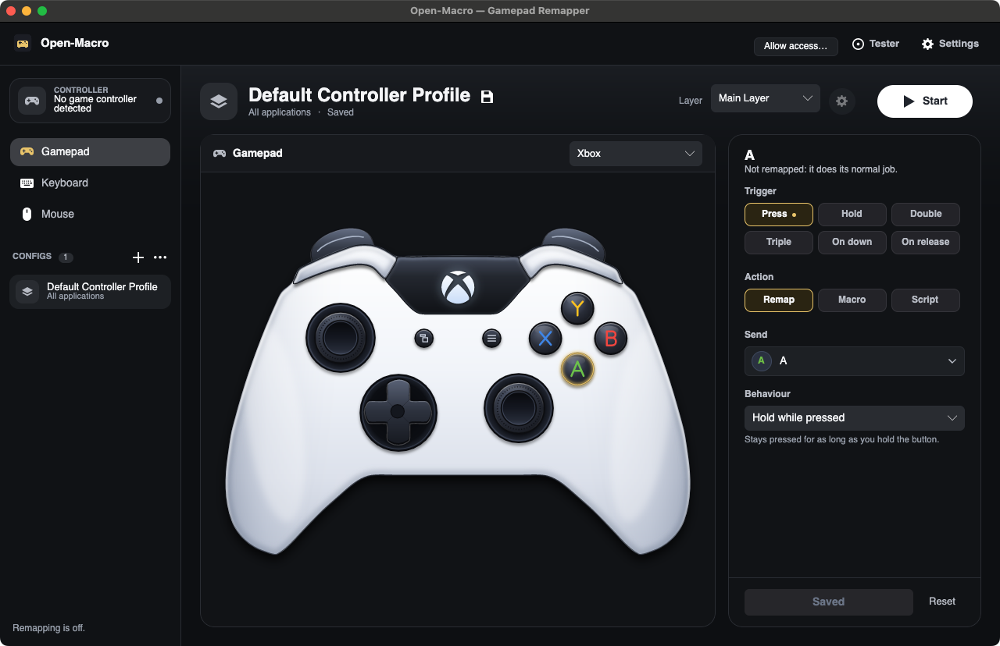
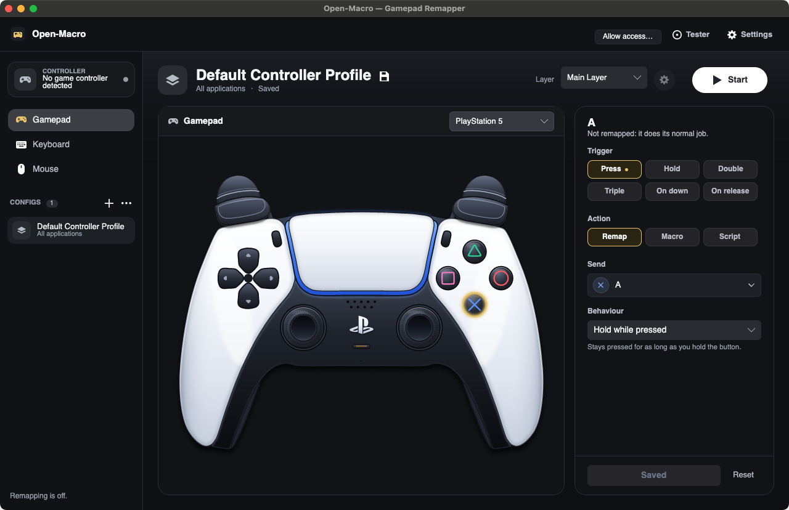
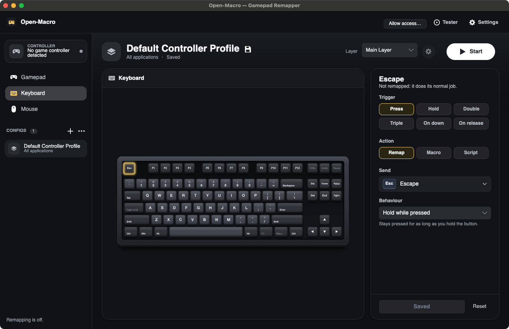
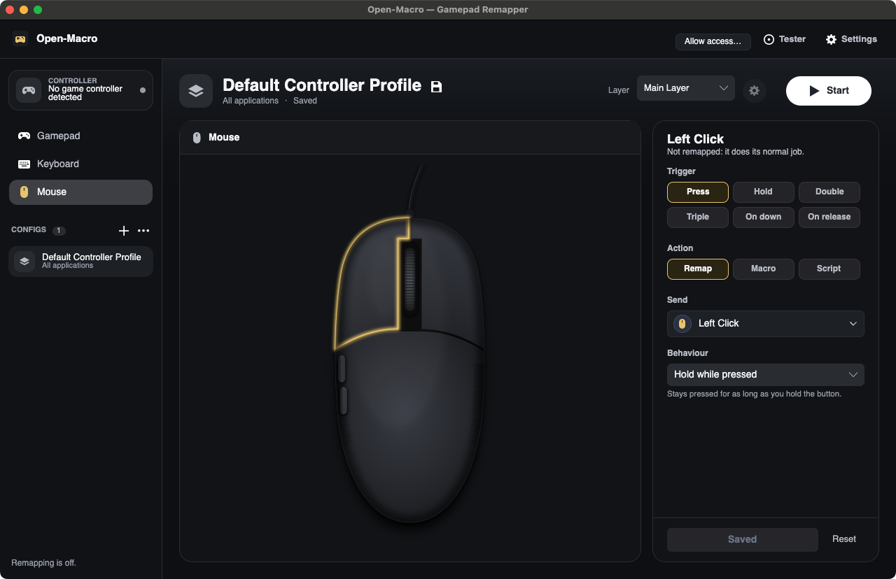

<h1 align="center">Open-Macro</h1>

<p align="center">
  A gamepad, keyboard and mouse remapper for Windows and macOS.<br>
  Turn any button, stick or key into something else: keys, clicks, macros, scripts and more.
</p>

<p align="center">
  <a href="https://github.com/ItzMeKoala/ReWASD-Open-Source/actions/workflows/ci.yml"></a>
  <a href="https://github.com/ItzMeKoala/ReWASD-Open-Source/releases/tag/latest"></a>
  
  
</p>

<p align="center">
  
</p>

Open-Macro reads your controller, keyboard and mouse, and sends something different to your computer. Press a button and
get a key, hold a stick and move the cursor, tap twice and run a macro, point at a slice of a wheel and open an app. Everything
is edited by clicking the part you want to change on a detailed drawing of the device.

It is a from-scratch recreation of the ideas behind the commercial reWASD, written in C# on .NET 9. It has a native window on each
system (WPF on Windows, Avalonia on macOS) on top of one shared engine, and saves the same config files on both.

> **Status:** alpha. It is used and tested every day, but the macOS controller and vibration code has so far been tried on few real
> pads. Please report what you see.

## Contents

- [Download](#download)
- [Quick start](#quick-start)
- [What it can do](#what-it-can-do)
- [Windows and macOS compared](#windows-and-macos-compared)
- [Permissions and drivers](#permissions-and-drivers)
- [Build from source](#build-from-source)
- [How it is built](#how-it-is-built)
- [Contributing](#contributing)
- [Documentation](#documentation)
- [Credits, trademarks and licence](#credits-trademarks-and-licence)

## Download

Every change that reaches `main` is built, tested on both systems and published as the
[latest release](https://github.com/ItzMeKoala/ReWASD-Open-Source/releases/tag/latest).

| System | File | Install |
|---|---|---|
| Windows 10 or 11, 64-bit | `ReWASD-win-x64.exe` | Double-click it. One self-contained file; nothing to install. |
| macOS 12 or later, Apple silicon | `ReWASD-osx-arm64.zip` | Unzip, then open `ReWASD.app`. |
| macOS 12 or later, Intel | `ReWASD-osx-x64.zip` | Unzip, then open `ReWASD.app`. |

The project was renamed to Open-Macro; the file names, the app bundle, its identifier and the config folder still use the old name, `ReWASD`, so
existing installs keep updating and keep their configs and permissions.

The app is not signed with a paid developer certificate. On a Mac, right-click `ReWASD.app` and choose **Open** the first time.
On Windows, SmartScreen may ask you to confirm: choose **More info**, then **Run anyway**.

**Updates.** When it starts, the app looks for a newer build and shows **Update available**. One click downloads it, replaces the
app and restarts it. Preferences has a switch to turn the check off. A copy you built yourself cannot replace itself; pull and
rebuild instead.

## Quick start

1. Open the app and plug in or pair a controller. The card at the top of the left rail names the controller in use.
2. Pick **Gamepad**, **Keyboard** or **Mouse** in the left rail, then click a part of the drawing. It gets a gold outline.
3. In the editor on the right choose **when** it fires (Press, Hold, Double, Triple, On down, On release), **what** it does (Remap,
   Macro or Script) and **how** it behaves (hold while pressed, repeat, toggle, one pulse).
4. Press **Start**, the white button at the top right. The mapping works in every app until you stop it.
5. Changes save by themselves, and your configs are listed in the rail. **Settings** holds sticks, timing, configs, integrations, window and system options.

Shortcuts (use Cmd instead of Ctrl on a Mac): `Ctrl+S` save, `Ctrl+,` settings, `Ctrl+Enter` start or stop remapping, `F11` the
full-screen tester, `Esc` leave settings or the tester.

**Panic key.** `Ctrl + Alt + Shift + F12` on Windows, `Control + Option + Shift + F12` on a Mac (hold `fn` on laptops with media
keys). It always works, even if a mapping has swallowed keys you needed.

## What it can do

### Remap anything

- **Controller, keyboard and mouse as inputs.** Every button, trigger and stick direction on a controller; every key on a
  tenkeyless keyboard, punctuation and right-hand modifiers included; every mouse button and the wheel.
- **Outputs:** keyboard keys, mouse buttons, scrolling, mouse movement, other controller buttons (Windows), macros and scripts.
- **Activators:** single press, long press, double, triple, on down and on release, each with its own action.
- **Behaviours:** hold while pressed, turbo (repeat while held), toggle, one-time pulse.
- **Shift layers** that change what the same buttons do while one is held, including switching a stick's mode.
- **Sticks** can be a stick, a mouse cursor, a scroll wheel or keys (W A S D, arrows, any keys, with diagonals). Deadzones, curve,
  sensitivity, flips, and precision aiming while a button is held. **Measure drift** and **Measure reach** set deadzones for you.

### Combos, macros and scripts

- **Chords** (A + B together) and **sequences** (Up, Up, Down, Down), set by typing or by pressing **Capture** and using the pad.
- **Macros** are step lists such as `KeyTap:A; Delay:100; OpenUrl:https://example.com`. Besides keys, mouse and pad steps they can
  open pages, start apps, run commands, send web requests (GET, POST, PUT, DELETE, PATCH), type text, vibrate the pad and control
  OBS Studio over WebSocket 5. A **recorder** captures keys and mouse by doing them.
- **Scripts** are small JavaScript programs (run by [Jint](https://github.com/sebastienros/jint); nothing to install) with `press`,
  `hold`, `click`, `scroll`, `moveMouse`, `type`, `delay`, `shell`, `openURL`, `webhook`, `obs`, `padPress`, `notify`, the app in
  front (`app.is('chrome')`) and `state` that survives between presses. Anything a script leaves held is released when it ends.
- **Command wheel:** hold a button, point a stick at a slice, let go and the slice runs. Up to eight slices per config.

### Profiles that follow you

- A config can **target an app**: while that app is in front the config takes over, and yours returns when you leave. On Windows
  match a program name (`game.exe`), on macOS an app name or bundle id (`Safari`, `com.apple.Safari`).
- **Import and export** configs. One from somebody else that can run commands, start programs, call web addresses, drive OBS or run
  scripts is listed for your approval before it loads.
- **History** keeps the newest 20 copies before any delete, overwrite or restore, and brings any of them back.
- **Presets** to start from: couch mouse, WASD game, presentation clicker.
- **Lock:** hold a set of buttons for a second to freeze the controller; again to unfreeze. Keyboard and mouse mappings carry on.

### Drawings that follow the real device

The pictures are not icons. They are drawn from a small SVG dialect, lit like the real thing, and they move with your hardware.

<table>
  <tr>
    <td width="50%"></td>
    <td width="50%"></td>
  </tr>
  <tr>
    <td><b>Controllers.</b> Xbox and PlayStation 5 are drawn in full; PlayStation 4 and Switch Pro have outline drawings. Buttons sink
    and glow while held, triggers pull down with the analog value, sticks lean and shrink when clicked.</td>
    <td><b>Keyboard.</b> A tenkeyless keyboard with sculpted keycaps. Keys sink while you press the real ones, remapped keys carry a dot,
    and every key can be remapped except <code>Fn</code>.</td>
  </tr>
  <tr>
    <td width="50%"></td>
    <td>
      <b>Mouse.</b> A wired gaming mouse seen from above: two buttons, a ribbed wheel whose top and bottom light for a notch up or down,
      and two thumb buttons. Buttons follow the real mouse while Open-Macro is in front, and everywhere while remapping runs.
    </td>
  </tr>
</table>

### Live readings and the controller tester

Make the window larger and the controller keeps its size while live readings appear underneath: both sticks with their circle,
push, angle, circle error and drift, trigger pressure with the highest pull, how often the pad reports and, with
enough height, a graph of the last six seconds. **F11** opens the full-screen tester, which fits on one screen with nothing to scroll:

- **Sticks:** live position, the path just taken and your deadzone rings. Roll a stick around its edge to run the **circularity
  test**, which reports how far the edge it reaches is, on average, from a perfect circle. Under each stick, the buttons on that half
  of the pad: state, press count, hold times, and **switch bounce** (a release and press under 30 ms apart).
- **Triggers:** pressure and, under it, a **travel** chart that shows where along the pull the trigger reported and where it skipped.
- **Last 6 seconds and timing:** a graph of every axis, reports per second, the usual gap and jitter, measured by a fast dedicated
  thread.
- **Vibration test** (big left and right motor buttons, a *both* switch that shakes both at once, and an *∞* switch that makes them keep going) and a **reaction test** you start by clicking the box. Copy or save the
  numbers as a report.

The controller is only sampled fast while the tester or live readings are on screen.

### Around the edges

- **Overlay:** a small always-on-top window showing the animated controller, for streams (capture it as a window in OBS).
- **Menu bar or notification-area icon:** show the window, start or stop remapping, lock, overlay, quit. Optionally keep running
  when the window closes, and on a Mac hide the Dock icon.
- **Usage counts** of buttons pressed, macros run and time remapping was on. Kept on your computer only.

The full list, with every setting and what is deliberately left out, is in [docs/features.md](docs/features.md).

## Windows and macOS compared

| | Windows | macOS |
|---|---|---|
| Controller, keyboard and mouse to keys, clicks, scrolling, macros, scripts, layers | Yes | Yes |
| Combos, command wheel, per-app configs, overlay, tester, live readings | Yes | Yes |
| Same config files on both | Yes | Yes |
| Controllers read through | XInput | Apple GameController (Xbox, DualShock 4, DualSense, Switch Pro, MFi) |
| Virtual Xbox 360 or DualShock 4 controller | Yes, with ViGEmBus | No |
| Hide the physical controller from games | Yes, with HidHide | No |
| Vibration (test buttons and macro steps) | Yes | Yes, on Xbox, DualSense and DualShock 4 pads |
| Permissions to grant | None | Accessibility and Input Monitoring |

macOS has no way for an ordinary app to present a virtual game controller or to hide a device without also cutting itself off, so a
mapping to another pad button does nothing there. [docs/macos.md](docs/macos.md) explains the details.

## Permissions and drivers

**Windows.** Nothing is required for keyboard, mouse and macro output. For a virtual controller install
[ViGEmBus](https://github.com/nefarius/ViGEmBus); to hide the physical pad from games install
[HidHide](https://github.com/nefarius/HidHide). Preferences shows whether each is ready. Controllers are read through XInput.

**macOS.** The system only lets an app watch the keyboard and mouse, or press keys for you, once you allow it. Open
**System Settings, Privacy & Security** and turn Open-Macro on under both:

- **Accessibility** to press keys, move the mouse and swallow the originals of remapped keys.
- **Input Monitoring** to see real key and mouse presses.

The top bar shows an **Allow access…** button until both are granted; it asks for them. After granting, restart the app. When
run from a terminal, the permission belongs to that terminal app.

**Your data.** Configs live in `%APPDATA%\ReWASD-OpenSource\profiles` on Windows and
`~/Library/Application Support/ReWASD-OpenSource/profiles` on macOS, as plain JSON. Nothing is sent anywhere except what you set
up yourself (webhooks, OBS) and the update check, which asks GitHub for the latest release.

## Build from source

You need the [.NET 9 SDK](https://dotnet.microsoft.com/download/dotnet/9.0). The whole solution builds and its tests run on
Windows and macOS; the Windows front end only runs on Windows.

```sh
git clone https://github.com/ItzMeKoala/ReWASD-Open-Source.git
cd ReWASD-Open-Source

dotnet build ReWASD.sln
dotnet test ReWASD.sln
```

Make an app you can double-click:

| Goal | Command | Result |
|---|---|---|
| Mac app for this Mac | `./build.sh` | `dist/ReWASD.app` |
| Windows exe | `Build.cmd` or `.\build.ps1` | `dist\ReWASD.exe` |
| Windows exe from a Mac | `./build.sh windows` | `dist/ReWASD.exe` |
| Build, then open it | `./build.sh --run` | |

Run from source without packaging:

```sh
dotnet run --project src/ReWASD.UI.Mac    # macOS
dotnet run --project src/ReWASD.UI        # Windows
```

The status line in the rail shows the version and git commit a build was made from, so you can tell which build you are running.

## How it is built

```text
src/
  ReWASD.Core      Models, config serialization, controller skins, the SVG art parser and the keyboard and mouse drawings
  ReWASD.Engine    Remapping engine, input pipeline, macros and scripts, and the platform backends:
                     Windows: XInput, low-level hooks, SendInput, ViGEm, HidHide
                     macOS:   GameController, event taps, Quartz events, haptics
  ReWASD.App       View models shared by both front ends: editor, tester, updates, profiles
  ReWASD.UI        Windows front end (WPF)
  ReWASD.UI.Mac    macOS front end (Avalonia)
tests/
  ReWASD.Tests            Engine, core and shared logic
  ReWASD.UI.Mac.Tests     Avalonia front end, run headless
  ReWASD.UI.Tests         WPF front end (Windows only)
```

The path of one input:

```text
physical controller / keyboard / mouse
        |            platform backend: XInput or GameController, low-level hook or event tap
        v
  InputPipeline  ->  MappingEngine  ->  activators, layers, stick modes, combos
        |                                       |
        v                                       v
  macros and scripts  ----------->  output: keys, mouse, virtual pad (Windows), vibration
```

Everything above the platform backends is shared, so a mapping behaves the same on both systems. The drawings are described in a
small SVG dialect (`data-button`, `data-key`, motion and glow settings) that `SvgArtParser` turns into a scene each front end renders
with its own toolkit.

Built with [.NET 9](https://dotnet.microsoft.com/), [Avalonia](https://avaloniaui.net/),
[Jint](https://github.com/sebastienros/jint), [CommunityToolkit.Mvvm](https://github.com/CommunityToolkit/dotnet) and
[Nefarius.ViGEm.Client](https://github.com/nefarius/ViGEm.Client).

## Contributing

Changes are made on a branch and pushed. [CI](.github/workflows/ci.yml) builds and tests on Windows and macOS for every branch; on
Windows it also opens the real WPF window to catch mistakes tests cannot. Once CI is green the change goes to `main`, and the
[release workflow](.github/workflows/release.yml) builds the Windows exe and both Mac apps and updates the `latest` release.

Before you open a change:

- `dotnet build ReWASD.sln` and `dotnet test ReWASD.sln` pass.
- Both front ends get the same change. A feature added to the WPF window needs its Avalonia counterpart, and the other way round.
- The look stays quiet: one gold accent, flat panels, and realistic shading only inside the device drawings.
- New behaviour comes with a test, and [docs/features.md](docs/features.md) is updated.

## Documentation

| | |
|---|---|
| [docs/features.md](docs/features.md) | Every feature and setting, and what is not included |
| [docs/macos.md](docs/macos.md) | Running on a Mac: install, permissions, what differs |
| [docs/research.md](docs/research.md) | How the behaviour was researched, and the tools used |
| [docs/rewasd-remap-macro-analysis.md](docs/rewasd-remap-macro-analysis.md) | Notes on how remaps, activators and macros are structured |
| [docs/ui-structure.md](docs/ui-structure.md) | How the editor's layout maps to the original's |
| [docs/design/](docs/design) | Standalone previews of the Xbox and DualSense drawings that react to a real controller in a browser |

## Credits, trademarks and licence

This project is independent. It is not made by, affiliated with or endorsed by Disc Soft, the makers of reWASD. It was built by
studying how such tools behave and writing everything again from scratch; no code, images or other assets were copied.

Several features were inspired by the feature list of [ControllerKeys](https://github.com/NSEvent/xbox-controller-mapper). Its source
is under a non-commercial licence, so none of its code is used here.

The PlayStation logo and the Xbox sphere in the drawings are the public-domain "PlayStation logo.svg" and "Xbox one logo.svg" from
Wikimedia Commons. PlayStation and DualSense are trademarks of Sony Interactive Entertainment; Xbox is a trademark of Microsoft.
They are named and drawn only to show which controller is meant.

No licence has been chosen for this repository yet, so until one is added the usual default applies: others may not copy or reuse
the code. If you want to use it, open an issue.
